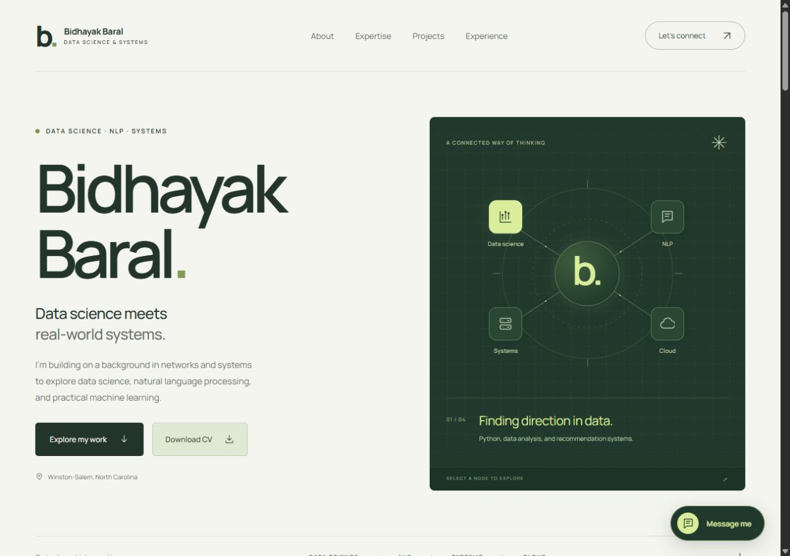

# Bidhayak Baral — Personal Portfolio

A responsive personal website bringing together data science, NLP, networking, and systems projects. Built with HTML, CSS, and JavaScript, with a working Python recommendation engine running in the browser through Pyodide.

**Status:** Working website and browser demo.  
[Visit the portfolio](https://bidhayak.com/) · [Try the job recommender](https://bidhayak.com/job-recommender.html)



## Highlights

- Responsive layout, mobile navigation, keyboard-accessible controls, and an interactive skills map.
- Job recommendation demo using the original Python TF-IDF and cosine-similarity ranking code.
- Resume text input, TXT uploads, illustrative job examples, optional job CSV imports, explanations, and CSV export.
- Project case studies covering the job recommender, Arduino-based patient monitoring, incident investigation, and Packet Tracer coursework.
- Downloadable CV and a contact dialog using FormSubmit.

## Run locally

Install Node.js, then run from this repository:

```bash
node server.mjs
```

Open [localhost:4173](http://127.0.0.1:4173). No npm packages or build step are required. The browser recommender loads its Python runtime and packages from external CDNs when matching starts, so it requires internet access.

## Project structure

```text
dist/
  index.html                 # Portfolio content
  style.css                  # Layout and styling
  script.js                  # Navigation, skills map, and contact dialog
  job-recommender.html        # Browser demo
  recommender.js             # Demo interface
  projects/job-recommender/   # Python engine, adapter, worker, and example jobs
  downloads/                 # Packaged original Streamlit project
docs/                        # README preview
scripts/prepare-capstone.py   # Rebuilds the browser engine and source ZIP
server.mjs                   # Local development server
```

The `dist/` directory contains the website's source assets and is intentionally tracked. Serve its contents with a static host. The included Node server is intended for local development.

## Browser recommender

The browser edition executes extracted ranking classes and text helpers in a module Web Worker. It uses unigram/bigram TF-IDF and cosine similarity; shared terms and skills explain the ranking. The small browser corpus uses `min_df=1` and `max_df=1.0`.

Resume and job inputs are processed in the browser without uploading them to an application server or saving them in browser storage. The ten built-in roles are illustrative examples. The browser edition does not retrieve live vacancies.

To regenerate the extracted engine and downloadable Streamlit ZIP from a local copy of the original capstone:

```bash
python scripts/prepare-capstone.py /path/to/job-recommendation-system
```

## Checks

```bash
node --check dist/script.js
node --check dist/recommender.js
node --check dist/projects/job-recommender/worker.mjs
```

## Content and services

The contact dialog sends submitted contact details and messages to FormSubmit. It includes validation, a honeypot, pending/error states, and a direct email fallback.

The site includes an intentionally public CV and contact information. Hosting account configuration, credentials, private datasets, school archives, and private source notes are excluded from this repository.

The patient-monitoring case study describes documented interim work; GSM, GPS, and full web integration were planned extensions. The network diagram is a conceptual skills map. No clinical validation, hiring-success rate, or unverified project outcomes are claimed.

## Credits

Created for Bidhayak Baral. The bundled Manrope font includes its upstream license at `dist/fonts/OFL.txt`.
